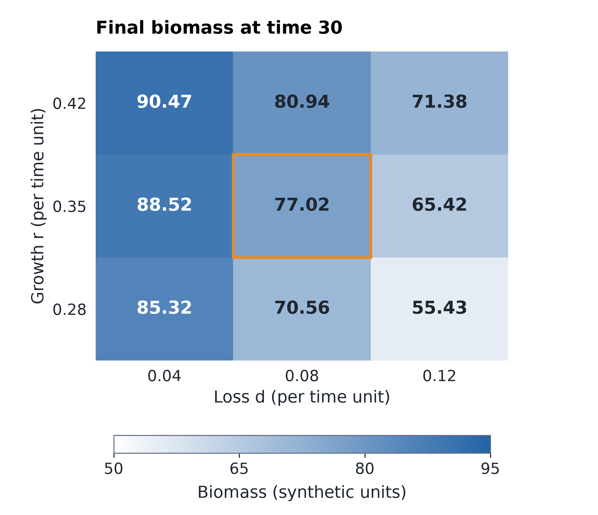

# MCM A/B/C 数学建模团队

一套从题目拆解、建模求解到英文论文和科研图表的协作模板。Codex 与 DSH 共用 12 类角色、任务交接规则和写作参考。项目记录把题问、模型、计算结果、图表和审阅绑定到具体版本。

| 使用方式 | 当前状态 | 文档 |
| --- | --- | --- |
| **Codex** | `$mcm-team` 入口与新项目模板可用。原生角色绑定和 Hook 拦截仍待运行时验收，严格预检会阻止正式自动派发。 | [安装、预检与回滚](docs/Codex使用说明.md) |
| **DSH** | 维护线为 v0.2.1，提供项目模板和原生派发门禁。实际部署版本和能力以安装收据与运行时读回为准。 | [v0.2.1 说明](docs/v0.2.1更新说明.md) · [更新与回滚](docs/更新与回滚.md) |

## 快速开始

### Codex

在仓库根目录运行，需要 Python 3.11 或更新版本。

```powershell
python tools/install-codex-skill.py preview
python tools/install-codex-skill.py install
python tools/codex-project.py new --destination 'D:/MCM/practice-01'
```

在 Codex 中打开新目录，输入 **“使用 `$mcm-team` 检查这个项目”**。题面放入 `input/problem/`，附件放入 `input/attachments/`。已有项目可用 `python tools/codex-project.py preview --destination '<项目目录>'` 查看差异。

首次进入项目时，可运行 `python scripts/mcm.py codex capabilities` 和 `python scripts/mcm.py codex preflight` 查看当前能力与阻断原因。需要重建适配配置时，运行 `node adapters/codex/build.mjs`。

### DSH

按[更新与回滚说明](docs/更新与回滚.md)安装或更新预设，再建立独立项目。新会话选择 **“美赛 · 队长”**，设置项目工作目录并使用[启动词](启动词.txt)。

```powershell
pwsh -File tools/new-project.ps1 -Destination 'D:/MCM/practice-01'
```

## 团队怎样协作

| 阶段 | 主要交付 | 人工关口 |
| --- | --- | --- |
| 题意与证据 | 题问清单、规则、数据来源、验证条件 | H0 选题 |
| 候选建模 | 独立方案比较、主模型、假设与接口 | H1 模型路线 |
| 求解与独立验证 | 可复现代码、冻结结果、对照和灵敏性分析 | H2 核心结果 |
| 写作与整合 | 英文论文、图表、LaTeX 源码和逐页复核 | H3 最终稿 |

队长负责调度和全局登记。建模负责人组织独立提案，默认两个编程实例分别负责求解和实验导出。论文负责人统一整合写作、图表和排版成果。验证与审阅由非作者完成。Codex 的实际子 Agent 由根队长统一创建，主管负责拆任务与整合。

任务按固定输入版本和独占写入范围交接。上游结果变化时，依赖的图表、摘要和审阅随之失效。详见[协作协议](docs/协作协议.md)、[角色与专项 Skill](docs/角色与专项Skill.md)和[角色架构图](diagrams/01-role-architecture.png)。

## 论文与图表

[七部分写作骨架](project-template/resources/mcm-skills/o-award-framework.md)依次组织题目、摘要与关键词，接着是问题重述与分析、假设与符号、模型建立与求解、灵敏性、模型评价和参考文献。AI 使用报告与必要附录另行安排，当年规则和题目要求优先。

每个子问交代目标、继承输入、基线、模型、求解、结果、验证和下问接口。每个必要的结论小节用对应的图或表支撑主要发现。项目通过 [章节图表映射模板](project-template/templates/section-visual-map.json)核对引用和文件版本，由非作者检查图文一致性及实际入稿效果。

- [34 条图表案例索引](adapters/codex/skill/references/chart-gallery.html)提供队号、页码、图号和迁移点评。下载 HTML 后可在本地筛选。
- [图表选型速查](project-template/resources/mcm-skills/chart-reference.md)与[六种可运行配方](skill-overlays/nature-figure/references/mcm-visual-recipes.md)覆盖残差对照、敏感性、Pareto 权衡、配对分布、策略小图和空间小图。
- [科研图表使用说明](docs/美赛图表Skill使用.md)说明如何从冻结数据导出 PDF、SVG 和 PNG，并检查最终字号、图例、区间与版面。
- [优秀论文呈现经验](project-template/resources/mcm-skills/presentation-lessons.md)把实际读页转为机制、公式、验证与决策的写作方法。[三维图配方](docs/figure-recipes/advanced/README.md)提供响应曲面和空间轨迹，配等高线或二维投影读数。
- [终稿自动检查与纠错](docs/论文呈现升级与自动纠错.md)从独立副本编译、逐页渲染，并安全修复简单超宽插图；复杂版式进入整改闭环，仍需非作者实际看图。

[四页三维图入稿与纠错试样](docs/figure-recipes/advanced/specimen/presentation.pdf)已实际编译并逐页独立复验，包含同数据等高图和空间投影。它是合成布局测试，供检查实际字号、图注与页面效果。

## 看成品与验收

[四页合成演练论文](examples/codex-smoke/paper.pdf)用四图一表覆盖五个必要小节，包含研究路线、参数表、求解误差、敏感性热图和参数包络。



[复现说明](examples/codex-smoke/README.md)提供模型、代码与冻结数据。[独立复核](examples/codex-smoke/independent-demo-review.json)记录数值重算和逐页检查。[Codex 候选验收](audit/codex-adapter-2026-11-03/README.md)记录实际测试范围和原生运行时缺口。

<details>
<summary>维护与历史记录</summary>

- [仓库同步约定](docs/GitHub同步.md)
- [DSH v0.2.1 验证记录](audit/v0.2.1/verification.json)和[历史部署记录](audit/v0.2.1/deployment.json)
- [v0.2.0 七页合成演练](rehearsal-v2/build/paper/demo.pdf)和[历史交付说明](docs/交付与验收.md)

</details>
